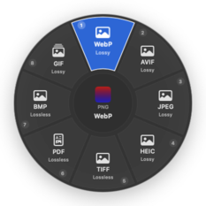
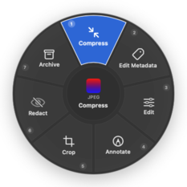
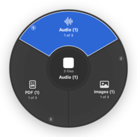
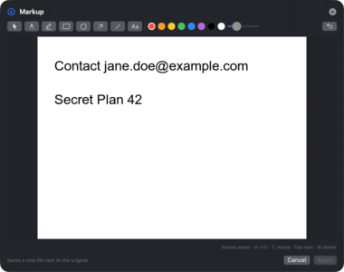
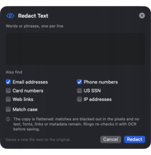

# Ringo

Ringo converts and edits files from a radial menu that opens next to your pointer in Finder. Select files, double-tap ⇧ Shift, pick a format, and the new file appears beside the original. Double-tap ⌘ Command instead for file tools: compress, metadata, edit, annotate, crop, redact and archive. A command-line tool with the same name, `ringo`, uses the same engine for scripts and agents.

Everything runs on your Mac. Ringo never uploads files, never calls a server, and has no telemetry or account.

<p>



</p>

## Install

Ringo needs macOS 14 or later and builds with the Xcode Command Line Tools (Xcode itself is not required).

```bash
git clone <this repository> ringo && cd ringo
scripts/build-app.sh            # builds build/Ringo.app with the CLI inside it
open build/Ringo.app            # first launch shows a short setup window
```

To use the CLI outside the app bundle, open Settings → Advanced → Install, or link it yourself:

```bash
ln -s "$PWD/build/Ringo.app/Contents/Helpers/ringo" /usr/local/bin/ringo
```

Shell completions for zsh, bash and fish are written to `completions/` by the build script.

### Optional tools

Ringo handles images, PDFs, documents, spreadsheets, subtitles, archives, fonts and Apple audio/video formats with macOS frameworks alone. Some formats need a tool you install yourself; Ringo finds it automatically and never downloads anything:

| Tool | Adds | Install |
|---|---|---|
| FFmpeg | MP3, OGG, Opus, WMA, FLAC; MKV, WebM, AVI, WMV; video GIFs; most audio/video tools | `brew install ffmpeg` |
| ImageMagick | WebP output | `brew install imagemagick` |
| Pandoc | Higher-fidelity Markdown, DOCX, ODT and EPUB conversion | `brew install pandoc` |
| LibreOffice | DOC/XLS/PPT input, PPTX → PDF and images, Office → PDF with Office-like layout | `brew install --cask libreoffice` |
| Apple Pages / Keynote | Pages and Keynote files, PDF → Pages | Mac App Store |
| librsvg, Ghostscript, Calibre, woff2, Assimp, LibreDWG | Vector SVG → PDF, stronger PDF compression, e-books, WOFF2, glTF/FBX, DWG | Homebrew |

`ringo providers doctor` lists what is installed and what each missing tool would unlock. On the development machine, 429 of 462 conversion routes were available with FFmpeg, ImageMagick, Pandoc and librsvg installed; see [FORMAT_MATRIX.md](FORMAT_MATRIX.md).

## Using the radial menu

1. Select one or more files in Finder (any folders, including the Desktop).
2. Double-tap **⇧ Shift** for Convert or **⌘ Command** for File Tools. The key combinations **⌃⇧R** and **⌃⌘R** do the same and need no extra permission.
3. Choose a wedge:
   - click or tap it, or turn the trackpad with two fingers to move around the ring;
   - press **1–8** to jump to a wedge and **Return** to run it;
   - use **← →** (or Tab) to move, **↓** to open a submenu, **↑** to go back;
   - type a format such as `webp` or `mp4` to search inside the ring.
4. The menu stays open until you run something, click outside it, or press **Escape**. Escape first clears a search, then leaves a submenu, then closes.

Outputs go into each file's own folder: `photo.png` → `photo.webp`, or `photo (converted).webp` when that name is taken. Tools add a label, such as `photo (compressed).jpg` or `contract (redacted).pdf`. Originals are never changed unless you ask for it explicitly on the command line (`--in-place`).

Actions with options (trim times, crop rectangle, markup, text to redact, metadata fields) open a small panel next to where the menu was. Return applies; Escape cancels.

<p>


</p>

### Permissions

- **Finder automation** (needed): the first time, macOS asks whether Ringo may control Finder. Ringo only sends "get selection".
- **Accessibility** (optional): needed for the double-tap triggers, because macOS shows other apps' modifier keys only to trusted apps. Ringo looks at key timing, never at what you type. Without it, use ⌃⇧R and ⌃⌘R.
- **Automation for Pages or Keynote**: asked only if you choose a conversion that needs those apps.

## Command line

The CLI works whether or not the app is running.

```bash
ringo photo.png webp                                  # shorthand for: ringo convert photo.png --to webp
ringo convert '*.heic' --to jpeg --quality 90         # Ringo expands quoted globs
ringo convert report.pdf --to png                     # every page at 300 DPI: report-p01.png, report-p02.png …
ringo convert book.xlsx --to csv --sheet all          # one CSV per sheet
ringo plan report.pdf --to docx                       # which provider, what survives, where the file goes
ringo compress clip.mov --preset small
ringo metadata strip IMG_0042.jpg                     # pixels untouched, GPS and EXIF removed
ringo redact contract.pdf --text "Jane Doe" --pattern email
ringo edit pdf scan.pdf --delete 2,5-7
ringo extract download.zip                            # into a new sibling folder, with traversal checks
ringo watch ~/Scans --to pdf --move-originals         # convert files as they arrive
ringo capabilities --from pdf --json                  # machine-readable capability discovery
```

Every command accepts `--json` and prints one document with schema `ringo/1`. `--events` streams progress as NDJSON on stderr. Exit codes are fixed: 0 success, 1 partial failure, 2 invalid arguments, 3 unsupported conversion, 4 missing provider, 5 input problem, 6 output problem, 7 cancelled or timed out, 8 verification failed, 9 provider failed, 10 internal error. [CLI.md](CLI.md) has the full reference and agent recipes.

## What converts to what

The short version, by category. [FORMAT_MATRIX.md](FORMAT_MATRIX.md) lists every directed edge, the provider that runs it, and what survives.

| From | To | Notes |
|---|---|---|
| JPEG, PNG, WebP, HEIC, TIFF, AVIF, BMP, GIF | each other, PDF | WebP output needs ImageMagick. Transparency, orientation and color profiles are handled; animations keep frames only into GIF. |
| SVG | PNG, JPEG, HEIC, TIFF, AVIF, BMP, GIF, PDF, WebP | Input only. Ringo does not trace bitmaps into vectors. |
| MP3, M4A, WAV, FLAC, OGG, Opus, AIFF, WMA | each other | M4A, WAV and AIFF work natively; the rest need FFmpeg. |
| MP4, MOV, MKV, WebM, AVI, WMV | each other, GIF, MP3 and other audio | Streams are copied when the container allows it. MP3 export fails clearly when there is no audio track. |
| PDF | PNG, JPEG (all pages, 300 DPI), TXT, Markdown, DOCX, EPUB, HTML, PPTX, XLSX, Pages | PDF → Office formats reconstruct text only; PPTX slides are page images; XLSX is experimental; Pages needs Apple Pages. |
| DOCX, Pages, Markdown, TXT, EPUB, RTF, RTFD, text clippings, HTML | DOCX, Markdown, TXT, EPUB, HTML, PDF, ODT, Pages | RTF, RTFD and clippings are input only; HTML is an export target that is also accepted as input. |
| PPTX, PPT | PDF, PNG, JPEG | Needs LibreOffice or Keynote. PPT is input only. |
| XLSX, ODS, CSV, TSV, XLS | each other, PDF | XLS is input only (LibreOffice). Formulas export as values. |
| SRT, VTT | each other, TXT | |
| ZIP, TAR, TAR.GZ, RAR | a folder, each other | RAR is input only. ZIP, TAR, TAR.GZ and GZIP creation is a tool. |
| Extras | OBJ/STL/PLY/USD, TTF/OTF ↔ WOFF/WOFF2, HWP/HWPX → text formats | From the Filee benchmark; some are experimental. |

## Privacy and safety

- No network access for any conversion or tool. A test runs the CLI inside a sandbox that denies the network ([TESTING.md](TESTING.md)).
- Outputs are written to a temporary file, synced, then renamed into place in one step, so a crash never leaves a half-written file under the final name and an existing file is never overwritten by accident.
- Redaction flattens pages to images, removes the text layer, fonts, links, forms and metadata, and re-checks the result with text extraction and OCR before saving.
- Archive extraction refuses absolute paths and `..` entries, removes links that point outside the new folder, and stops at a size limit.

[SECURITY.md](SECURITY.md) covers the threat model in detail.

## Documentation

| File | Contents |
|---|---|
| [ARCHITECTURE.md](ARCHITECTURE.md) | Modules, process model, provider protocol, data flow |
| [DESIGN.md](DESIGN.md) | Radial geometry, glass, opacity, motion, keyboard and trackpad behavior, accessibility |
| [CLI.md](CLI.md) | Commands, JSON schema, exit codes, agent workflows |
| [FORMAT_MATRIX.md](FORMAT_MATRIX.md) | Every format and directed edge, generated from the registry |
| [PARITY_MATRIX.md](PARITY_MATRIX.md) | Tangerine and Filee features with sources and Ringo's status |
| [SECURITY.md](SECURITY.md) | Local-only policy, subprocesses, archives, redaction |
| [DECISIONS.md](DECISIONS.md) | Architecture decisions, constraints and deferred work |
| [TESTING.md](TESTING.md) | Test suite, acceptance checklist, measurements |

## Building and testing

```bash
scripts/build-app.sh          # release build of Ringo.app and ringo
scripts/test.sh               # 120 Swift Testing tests
scripts/offline-test.sh       # conversions with the network denied
python3 scripts/gen-format-matrix.py build/Ringo.app/Contents/Helpers/ringo
```
