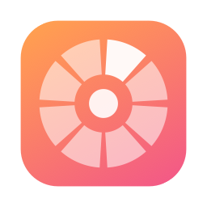

<p align="center">
  
</p>

<h1 align="center">Ringo</h1>

<p align="center">
  
  
  
  <a href="LICENSE"></a>
</p>

<p align="center">
  <b>Convert and edit files without leaving Finder.</b><br>
  Select a file, double-tap Shift, and choose a format. Everything happens on your Mac.
</p>

<p align="center">
  <a href="https://github.com/sjcsoftware/ringo/releases/latest"><b>Download for macOS</b></a>
  · <a href="#features">Features</a>
  · <a href="#getting-started">Getting started</a>
  · <a href="docs/CLI.md">CLI reference</a>
</p>

<table>
  <tr>
    <td width="50%" align="center"></td>
    <td width="50%" align="center"></td>
  </tr>
  <tr>
    <td align="center"><sub>Double-tap <kbd>⇧ Shift</kbd> to convert.</sub></td>
    <td align="center"><sub>Double-tap <kbd>⌘ Command</kbd> for file tools.</sub></td>
  </tr>
</table>

## Features

- **Convert where you work.** A radial menu opens beside your pointer with formats suited to the selected files. Mixed selections are grouped by category.
- **Everyday file tools.** Compress, edit metadata, annotate, crop, redact, and create or extract archives.
- **Keep your originals.** New files appear beside the source. Existing filenames are handled automatically, and successful jobs close the progress panel for you.
- **Stay local.** No uploads, accounts, telemetry, or conversion servers. macOS frameworks do the work, with optional local tools for more formats.
- **Use the keyboard or trackpad.** Click a wedge, scroll around the ring, type to search, or use number keys and Return.
- **Automate the same engine.** The bundled `ringo` CLI supports batch jobs, folder watching, conversion plans, and JSON output.

<table>
  <tr>
    <td width="50%"></td>
    <td width="50%"></td>
  </tr>
  <tr>
    <td align="center"><sub>Annotate images and PDFs.</sub></td>
    <td align="center"><sub>Redact text with local OCR verification.</sub></td>
  </tr>
</table>

## Install

Requires **macOS 14 Sonoma or later**. The downloadable build is for **Apple Silicon**.

1. Download `Ringo-1.1.0-arm64.dmg` from [Releases](https://github.com/sjcsoftware/ringo/releases/latest).
2. Open the DMG and drag **Ringo** into **Applications**.
3. Launch Ringo and complete the short setup.

The current release is ad hoc signed and is **not notarized**. macOS may require you to allow it in **System Settings → Privacy & Security → Open Anyway** after the first launch attempt.

## Getting started

1. Select one or more files in Finder.
2. Double-tap <kbd>⇧ Shift</kbd> to convert, or <kbd>⌘ Command</kbd> for file tools.
3. Choose an action. The output appears in the same folder as the original.

| Shortcut | Action |
| --- | --- |
| Double-tap <kbd>⇧ Shift</kbd> | Open Convert |
| Double-tap <kbd>⌘ Command</kbd> | Open File Tools |
| <kbd>⌃⇧R</kbd> / <kbd>⌃⌘R</kbd> | Open Convert / File Tools without Accessibility permission |
| <kbd>1</kbd>–<kbd>8</kbd>, then <kbd>Return</kbd> | Select and run a wedge |
| Arrow keys or <kbd>Tab</kbd> | Navigate the menu |
| Type a format | Search, including submenus |
| <kbd>Esc</kbd> | Clear search, go back, or close |

Double Shift and double Command work only while **Finder is in front with at least one file selected**, including files on the Desktop. They do nothing in other apps, with no selection, with only folders selected, or if Finder cannot return the selection. In a mixed file/folder selection, only files are used. This rule always applies, even if the Finder preference is disabled.

**Settings → General → Key combinations require Finder in front** controls the alternate key combinations only. The menu bar actions can read Finder's selection while another app is active and show permission or selection errors when needed.

**Permissions:** Finder Automation lets Ringo read your selection. Accessibility enables the double-tap shortcuts; the alternate keyboard shortcuts work without it. Pages and Keynote request Automation access only for conversions that use them.

Settings and recent outputs are available from the menu bar icon. Successful jobs dismiss the progress panel automatically; errors remain visible so you can inspect them.

## Formats and optional tools

Ringo supports images, audio, video, PDFs, documents, spreadsheets, subtitles, and archives. Available conversions depend on the source format and installed providers. See the [format reference](docs/FORMATS.md) for supported routes and fidelity limits.

| Optional tool | Adds | Install |
| --- | --- | --- |
| FFmpeg | More audio/video formats and media tools | `brew install ffmpeg` |
| ImageMagick | WebP output | `brew install imagemagick` |
| Pandoc | Additional document conversions | `brew install pandoc` |
| LibreOffice | Legacy Office input and Office-to-PDF conversion | `brew install --cask libreoffice` |
| Apple Pages / Keynote | Pages and Keynote conversions | Mac App Store |

Run `ringo providers doctor` to see available providers and what additional tools would unlock. Ringo never downloads providers automatically.

## Command line

Install the CLI from **Settings → Advanced → Install**, then use it from any terminal. The app does not need to be running.

```bash
ringo photo.png jpeg
ringo convert '*.heic' --to jpeg --quality 90
ringo plan report.pdf --to docx
ringo compress clip.mov --preset small
ringo metadata strip IMG_0042.jpg
ringo redact contract.pdf --text "Jane Doe" --pattern email
ringo watch ~/Scans --to pdf --move-originals
ringo capabilities --from pdf --json
```

See the [CLI reference](docs/CLI.md) for commands, JSON output, exit codes, and automation examples, and the [changelog](docs/CHANGELOG.md) for release changes. The [security notes](SECURITY.md) explain output handling, archive extraction, and redaction.

## Build from source

Install the Xcode Command Line Tools with a **Swift 6** toolchain, then:

```bash
git clone https://github.com/sjcsoftware/ringo.git
cd ringo
scripts/build-app.sh           # dist/Ringo.app, including the CLI
open dist/Ringo.app
```

To create a DMG or run the checks:

```bash
scripts/package-dmg.sh         # dist/Ringo-<version>-<arch>.dmg + SHA-256 checksum
scripts/test.sh
scripts/offline-test.sh        # conversions with network access denied
```

The build uses Swift Package Manager and ad hoc signing; a full Xcode installation is optional. Third-party license notices are included in the app bundle.

## License

Copyright © 2026 chaseungjoon. Released under the [MIT License](LICENSE).
